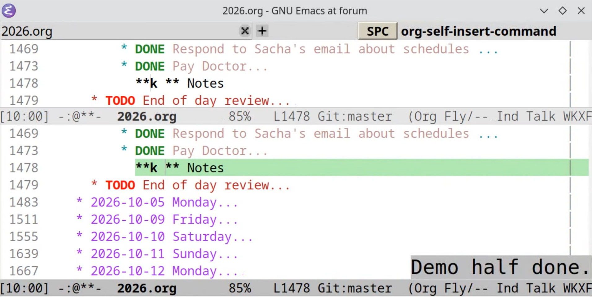

#+TITLE: talk-tools.el

This package is designed to help keep you on track when giving talks in Org-mode. It adds a timer to the toolbar, popup warnings and displays keys/commands used to help viewers understand the alchemy.

#+CAPTION: Talk tools screenshot

* Features

- *Presentation Timer*: Adds a timer to the left side of the Emacs tool bar.
- *Timed Warnings*: Displays pop-up alerts at set intervals in case you're not watching the timer.
- *Keycasting*: Displays keys and commands in tool bar.

* Requirements & Dependencies

- *~tool-bar-mode~*: Must be enabled for the presentation timer to be visible.
- *=keycast=* (Required): Used for displaying pressed keys and commands.
- *=posframe=* (Optional): If installed, time warnings will pop up in the lower-right corner of the frame.

* Installation

** MELPA (Once available)
#+begin_src elisp :results none
M-x package-install RET talk-tools RET
#+end_src

* Manual
#+begin_src elisp :results none
(use-package talk-tools
  :vc (:fetcher github :repo "eludom/talk-tools.el"))
#+end_src

- Usage

Enable the minor mode interactively with =M-x talk-tools-mode RET=.

Ensure tool-bar display is active:
#+begin_src elisp :results none
(tool-bar-mode 1)
#+end_src

When ~talk-tools-mode~ is active, the following default keybindings are available:

| Keybinding | Command            | Description              |
|------------+--------------------+--------------------------|
| ~C-c t~    | ~talk-tools-start~ | Start presentation timer |
| ~C-c T~    | ~talk-tools-stop~  | Stop presentation timer  |

- Configuration

Configure options interactively via =M-x customize-group RET talk-tools RET= with use-package:

#+begin_src elisp :results none
  (use-package talk-tools 
  :config
  (setq talk-tools-warning-font "Sans-32"
        talk-tools-warning-popup-seconds 5
        talk-tools-warnings '((0.1 . "6 second warning")
  			    (5 . "That's enough intro stuff")
                              (10 . "Demo half done.")
                              (15 . "Wrap up demo.")
                              (18 . "Two minute warning.")
                              (20 . "Finis. Questions?"))))

#+end_src

* Customization Options

- ~talk-tools-warnings~: List of warning messages and their trigger times.
- ~talk-tools-warning-font~: Font face or specification used for warning popups.
- ~talk-tools-warning-popup-seconds~: Duration (in seconds) the warning popup remains visible.

 
